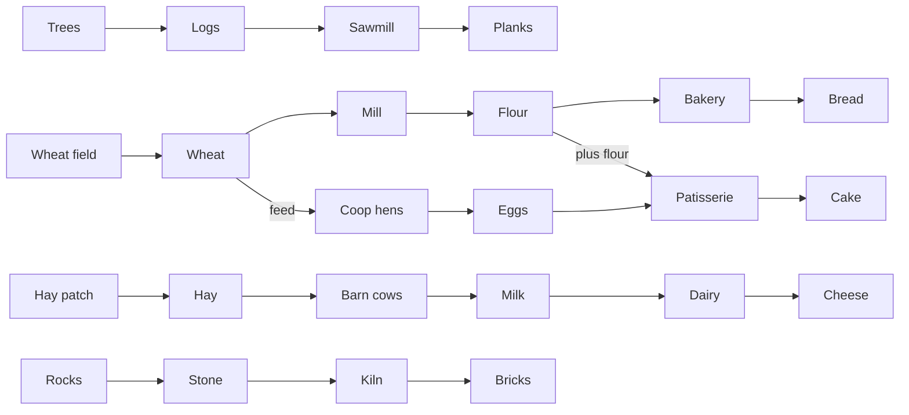

# Homestead — Game Design Doc (v1)

Oct 28, 2026 · @Josh Ouellette

## Overview

Homestead is a 3D low-poly gather-and-haul farm game for one player, built as a web app and played on an iPhone home-screen icon. You walk a farmer around a snowy homestead, harvest raw goods onto a stack on your back, sell or process them, and spend the cash on plots that expand the farm and automate it. Wolves raid at night; fences, dogs and turrets keep them off. Modeled on the Whiteout Survival playable ad.

**Design pillars**

1. One thumb. Every action is walking somewhere. No menus during play.
2. Relaxed by default. Neglect slows you down; nothing kills you or destroys buildings.
3. Early game you haul; late game the farm hauls for you and you chase orders.
4. Time runs only while the game is open. Deliberate: raids and orders need you present, and nothing accrues from leaving the app closed.

**v1 targets:** 6 zones, 6 machines (11 buildings plus a sell pad per zone), 14 cart routes, a Market orders board, about 5 hours to the Farmhouse (unverified until the balance simulator runs), 60 fps on a recent iPhone in Safari.

## Tech stack and deployment

Three.js in TypeScript, bundled with Vite, deployed to GitHub Pages as a PWA. No game engine on top; this genre needs a scene graph, a loop and simple collision, which three.js covers. Expect a codebase in the thousands of lines, not hundreds.

| Layer | Choice | Why |
| --- | --- | --- |
| Rendering | three.js (pinned release, npm) | Mature, runs well in iOS Safari WebGL |
| Language | TypeScript, strict | Claude Code catches its own mistakes faster |
| Build | Vite + vite-plugin-pwa | Service worker and offline for free |
| Joystick | nipplejs | Floating touch joystick, 1 line to set up |
| Assets | Kenney and Quaternius CC0 packs, glTF | Free low-poly trees, rocks, crates, carts, animals, a farmer |
| Physics | None; circle collision and a grid | A physics engine is overkill and costs frames |
| Content data | One `content.json` (zones, items, prices, costs) | Balance changes never touch code |
| Hosting | GitHub Pages via Actions on push to main | Phone icon points at the URL, updates on push |
| Save | localStorage JSON | Solo game, per device is fine |

**Install on phone:** open the URL in Safari, Share, Add to Home Screen. iOS ignores the manifest's orientation field, so the game is laid out for portrait only and shows a “rotate your phone” overlay in landscape. The home-screen app has its own storage, separate from the Safari tab, and iOS can evict web storage; test installed, not in a tab, and treat save export as the real backup.

**Performance rules for Claude Code:** instanced meshes for trees, wheat and fences; one directional light plus hemisphere; shadows on by default and dropped automatically if the first 10 s of play average under 50 fps (a toggle in the pause menu overrides); cap at 150 draw calls; test on the phone every phase, not at the end.

**Assets that no pack will have** (sawmill, mill, kiln, turrets) are built from primitives in code. Expect ad-adjacent, not an ad clone.

## Controls and camera

The only input is a floating joystick: touch anywhere, drag to walk, release to stop. Everything else is proximity.

**Proximity interactions**

| Where you stand | What happens | Timing |
| --- | --- | --- |
| Next to a resource node | Harvest animation, 1 item onto your stack per swing | 1 swing per 0.8 s base |
| On a sell pad (Yard table or a zone pad) | Unloads only while the joystick is released, so walking across sells nothing | 10 items per second once stopped |
| On a machine input pad | Matching items unload into its input pile | 10 items per second |
| On a machine output pad | Finished goods load onto your stack | 10 items per second |
| On an animal trough | Feed items unload until the trough is full | 10 items per second |
| On the Market stall with an order active | Order items unload first at the order price, then the rest sells at 1.5x | 10 items per second once stopped |
| On a route lever | Toggles that route between running and paused | Instant |
| On a dashed plot | A ring fills over 1.5 s and cash is paid in full when it completes; walk off early and nothing is charged | 1.5 s |
| On a build plot that needs materials | Matching materials unload first and stay in the plot (a counter shows 12/20); the cash ring only starts once materials are complete | Same |

**Pad rules:** a pad triggers within 1.0 unit of its center; pads sit at least 3 units apart; upgrade plots sit at least 3 units from any input pad; and no pad lies on the straight path between a pile and any other pad it feeds. A layout validator in the build checks all four against `content.json`.

Stack is a visible pile on your back; the top of the stack sways as you walk. Mixed item types are allowed; the stack shows them in the order picked up. Full stack shows a red cap icon and harvesting stops.

**Camera:** fixed isometric angle, about 35 degrees down, follows the player with a 0.1 s lerp. No rotate, no zoom in v1. Buildings between camera and player fade to 40% opacity.

**HUD:** cash top-right, carried count and capacity top-left, day/night dial top-center, a pause button. Nothing else. Plot prices float above the plot in world space, not in the HUD.

**Desktop fallback:** WASD and arrows move; same proximity rules. No extra features.

## Core loop

A session is: harvest, haul, spend, and watch the farm need you a little less.

1. Harvest a raw good from a node until your stack is full.
2. Carry it to a sell pad (cash now) or a machine (more cash later).
3. Spend cash on the next dashed plot: a zone, a building, a cart route, an upgrade.
4. Each building adds a chore; each cart route removes one.
5. When the howl sounds, get to the targeted zone before the wolves do.
6. Once the Market is open, chase orders: pull goods off the piles and hand-deliver them for 2x.
7. Repeat outward until the Farmhouse.

**First five minutes (tutorial by layout, no text):** you spawn beside three trees and a sell table. Chopping and selling is the only thing possible. The Sawmill plot sits 10 steps away priced at 60 cash plus 15 logs. The Field zone gate is visible but unaffordable. Nothing explains itself; the ad does not either.

**Sell or save:** selling a processed good now versus saving it for the next building is not a real choice; saving wins over any horizon longer than a few minutes. Treat it as a pacing lever: material costs set how long each building takes to earn, and the player feels progress in the pile growing.

**Hours 3 to 5, what your hands do:** once routes exist, income is passive, so the late game is built around four deliberate hand activities. Market orders are the main one: pull goods off piles and deliver them for 2x before the order expires. The others are hauling about 230 planks and 100 bricks of build materials (carts leave the last 10 items in every pile for you), delivering the Farmhouse’s 200 goods in person, and answering the howl every third night. The simulator reports late-game idle share; the target is under 30%, and workers move from v2 into v1 only if orders alone cannot get there.

## World and zones

Six fenced zones arranged in a loose ring around the Yard, each unlocked by a gate plot. Zones are hand-placed in `content.json`, not procedural. The whole map is about 120 by 120 units; walking across it takes 30 seconds at base speed.

| # | Zone | Gate cost (cash) | Raw node | Buildings in zone | What it gates |
| --- | --- | --- | --- | --- | --- |
| 1 | Yard | Free (start) | Trees (3) → logs | Sell table, Workbench, Sawmill | Everything |
| 2 | Field | 500 | Wheat field (12 plants) → wheat | Sell pad, Mill, Bakery | Feed for hens |
| 3 | Coop | 1,500 | Hens → eggs | Sell pad, Coop, Patisserie | Wolves begin |
| 4 | Pasture | 3,500 | Cows → milk; hay patch (8 plants) → hay | Sell pad, Barn, Dairy | Cheese |
| 5 | Quarry | 6,000 | Rocks (6) → stone | Sell pad, Kiln | Bricks for late buildings |
| 6 | Market | 9,000 | None | Market stall with orders board, Farmhouse plot | Premium prices, orders, the ending |

**Nodes regrow.** A tree gives 5 logs then regrows over 20 s. A wheat plant gives 1, regrows in 15 s. A hay plant gives 1, regrows in 15 s. A rock gives 4 stone, regrows in 30 s. Regrowth runs only while the game is open.

**Layout rule:** every node is within 8 seconds of walking from its machine, and every machine and trough is within 8 seconds of that zone’s sell pad. Walking is the chore; it should not be the punishment. The Yard-to-Market walk is the one long trip, and it is reserved for build materials, orders and the Farmhouse.

## Economy

Every recipe is 1 input to 1 output (cake takes two) and every processing step multiplies value 2.5x to 3x. Every number below is a first pass, unverified until the balance simulator runs in phase 2.

**Pacing rule the simulator enforces:** from the Field gate onward, each major purchase (a zone gate, a building, the Farmhouse) costs 8 to 15 minutes of the player’s income at the moment it unlocks; routes and upgrades cost 2 to 5 minutes. Yard purchases are faster, 1 to 3 minutes, so the first ten minutes feel like the ad. Total play time comes from the count of purchases times their minutes, not from any one price.

**Income by stage** (approximate cash per minute; hand = player working a lane, passive = routes running):

| Stage | What is built | Income per minute | Prices the next purchases |
| --- | --- | --- | --- |
| 1 | Yard, hand chopping, no Sawmill | 35 hand | Sawmill, first capacity level |
| 2 | Sawmill, hand-fed | 60 hand | Field gate, Mill |
| 3 | Field with Mill and Bakery, hand-fed | 120 hand | Coop gate, routes 1 to 2 |
| 4 | Yard and Field automated | 240 passive + 100 hand | Coop buildings, routes 3 to 6 |
| 5 | Coop and Patisserie automated | 400 passive | Pasture gate and buildings |
| 6 | Pasture and Dairy automated | 550 passive | Quarry gate, Kiln |
| 7 | Quarry and Kiln automated | 750 passive | Market gate and stall |
| 8 | Market stall, speed upgrades, herds at level 3 | 1,500 to 2,500 passive | Farmhouse |

Wheat and flour cross from the Field into the Coop; every other lane stays self-contained until its goods are sold or walked into the Farmhouse.

The Mermaid block above is the production chain diagram.

**Sell prices (cash per item).** Every zone from the Field on has a sell pad paying Sell-table prices, so raw goods and hay always have a nearby exit. The Market stall pays 1.5x for processed goods and refuses raw goods; orders pay 2x.

| Item | Kind | Sell table | Market stall |
| --- | --- | --- | --- |
| Log | raw, Yard | 1 | — |
| Plank | processed | 3 | 5 |
| Wheat | raw, Field | 2 | — |
| Flour | processed | 5 | 8 |
| Bread | processed | 12 | 18 |
| Egg | raw, Coop | 4 | — |
| Cake | processed | 25 | 38 |
| Milk | raw, Pasture | 8 | — |
| Cheese | processed | 20 | 30 |
| Stone | raw, Quarry | 6 | — |
| Brick | processed | 15 | 23 |
| Hay | feed, Pasture | 1 | — |

**Machines and buildings.** Build cost is cash plus a material stack you carry into the plot. Input and output piles hold 30; a machine idles when its output pile is full.

| Building | Zone | Recipe | Cycle (s) | Cash | Materials |
| --- | --- | --- | --- | --- | --- |
| Sell table | Yard | sells anything | — | free | — |
| Workbench | Yard | character upgrades | — | free | — |
| Sawmill | Yard | 1 log → 1 plank | 3 | 60 | 15 logs |
| Sell pad | Field to Quarry | sells anything at Sell-table prices | — | free with the zone | — |
| Mill | Field | 1 wheat → 1 flour | 3 | 500 | 20 planks |
| Bakery | Field | 1 flour → 1 bread | 4 | 1,000 | 25 planks |
| Coop (2 hens) | Coop | wheat → eggs | 30 per egg | 1,200 | 20 planks |
| Patisserie | Coop | 1 flour + 1 egg → 1 cake | 5 | 2,000 | 25 planks |
| Barn (2 cows) | Pasture | hay → milk | 45 per milk | 3,000 | 30 planks |
| Dairy | Pasture | 1 milk → 1 cheese | 5 | 4,000 | 40 planks |
| Kiln | Quarry | 1 stone → 1 brick | 5 | 6,000 | 40 stone |
| Market stall + orders board | Market | sells processed at 1.5x; posts orders at 2x | — | 10,000 | 40 bricks |
| Farmhouse | Market | the ending | — | 30,000 | 40 each of plank, bread, cake, cheese, brick, by hand |

**Cash sinks, first pass, unverified.** Required to finish (gates, buildings, Farmhouse): 78,260 cash plus materials. Buying everything on top (14 routes 33,700; character upgrades 26,140; herd, cart and machine upgrades; fence, dog and scarecrow in four zones 10,800; shotgun posts) is roughly 200,000. The simulator replaces both with measured figures.

**Market orders, the late-game loop.** Once the Market stall is built, a board beside it posts two orders at a time. Each order asks for 2 or 3 processed goods you can already make, 10 to 40 of each, pays 2x Sell-table price (above the stall’s 1.5x), and expires after 6 minutes of play. You fill it by hand: pull goods off piles, walk them to the stall, stand still. Completing or letting one expire posts a new one; there is no penalty for ignoring the board. Quantities scale with your carry capacity so an order is 1 to 3 trips, and the goods asked for rotate so no single lane is always the answer. Orders are the reason route 14 exists and the thing your hands do in hours 3 to 5.

## Animals and feeding

Animals produce only while their trough has feed. An empty trough pauses production; it never harms the animal.

| Animal | Lives in | Feed | Trough holds | Eats | Produces | Output pile |
| --- | --- | --- | --- | --- | --- | --- |
| Hen | Coop | Wheat (from Field) | 20 | 1 wheat per egg | 1 egg per 30 s | Egg pad, holds 30; doubles as the Patisserie’s egg input |
| Cow | Barn | Hay (from Pasture hay patch) | 20 | 1 hay per milk | 1 milk per 45 s | Milk pad, holds 30 |

**Hay patch:** 8 hay plants in the Pasture, scythed like wheat, 1 hay each, regrow in 15 s. Hay goes into the Barn trough or sells for 1 at the Pasture sell pad, so hauling it is nearly pure chore. This is deliberate: it is the first thing a cart route should remove.

**Herd upgrades:** plus 1 animal per level, 3 levels, priced at 50%, 100%, 200% of the building's cash cost. More animals drain the trough faster, so herd upgrades pull on the feed cart.

**Animal visuals:** chickens wander inside the coop fence and peck; cows stand and chew. No pathfinding beyond a random walk inside their pen.

## Carts and automation

Cart routes are predefined links between one source and one destination, bought as plots. No freeform rail laying in v1; it is the single biggest scope risk in this genre and the ad does not have it either.

A route is a rail with one cart that shuttles between a source pad and a destination pad. The cart loads up to its capacity from the source’s output pile, rides to the destination, unloads into its input pile (or sells at a table), and rides back. If the destination is full the cart waits.

**Piles, levers and harvesters.** Carts always leave the last 10 items in a pile for the player, so build materials and order goods can be collected without racing the automation. Every route has a lever on its rail that pauses it; walk onto it to toggle. When two routes share a source (routes 4 and 7 both draw on Mill output), the cart whose destination has the most free space loads first and takes only what that destination can accept; the simulator flags any lane that starves. A node-start route puts a harvester at the node that works at half the player’s base swing rate and drops into a node pile (holds 30) that the cart collects from; when that pile is full the harvester idles. Two harvesters on one node (routes 3 and 6 both reap the wheat field) alternate swings. The player can harvest the same node; it simply depletes faster. The Farmhouse plot is never a route destination.

**Route list (bought in any order once both ends exist):**

| # | From | To | Cash |
| --- | --- | --- | --- |
| 1 | Sawmill output | Sell table | 400 |
| 2 | Trees (auto-chop) | Sawmill input | 600 |
| 3 | Wheat field (auto-reap) | Mill input | 800 |
| 4 | Mill output | Bakery input | 1,000 |
| 5 | Bakery output | Field sell pad | 1,200 |
| 6 | Wheat field (auto-reap) | Coop trough | 1,500 |
| 7 | Mill output | Patisserie input | 2,000 |
| 8 | Patisserie output | Coop sell pad | 2,200 |
| 9 | Hay patch (auto-scythe) | Barn trough | 2,500 |
| 10 | Milk pad | Dairy input | 3,000 |
| 11 | Dairy output | Pasture sell pad | 3,500 |
| 12 | Rocks (auto-quarry) | Kiln input | 4,000 |
| 13 | Kiln output | Market stall | 5,000 |
| 14 | Market wagon: loops the Plank, Bread, Cake and Cheese piles | Market stall | 6,000 |

Routes 2, 3, 6, 9 and 12 start at a node and include the harvester described above. That is how zones go passive without workers. Route 14 is one cart with capacity 20 that visits each processed pile in turn; it lifts every lane to Market prices in one purchase and is the first thing to pause when an order wants those goods.

**Cart stats:** rails are real geometry, hand-placed per route in `content.json`. Cart speed 6 units/s; loop time = rail length × 2 ÷ 6, plus 2 s to load and 2 s to unload, so a 12-unit rail loops in 8 s and the Kiln-to-Market rail in about 40 s. Capacity 10 (route 14: 20). Cart upgrades per route: capacity doubles twice, at 50% and 100% of the route’s cost; they matter on the long rails and not on the short ones, which is fine.

**Visuals:** rails are low wooden tracks on the ground; the cart is a mine cart with the goods visibly stacked. Carts never block the player.

## Upgrades

Character upgrades are bought at a workbench plot in the Yard; building upgrades are a small plot beside each building. All cash only.

**Character (5 levels each)**

| Track | L0 | L1 | L2 | L3 | L4 | L5 |
| --- | --- | --- | --- | --- | --- | --- |
| Carry capacity (items) | 10 | 15 | 20 | 30 | 40 | 50 |
| Walk speed (units/s) | 4.0 | 4.4 | 4.8 | 5.3 | 5.8 | 6.4 |
| Harvest swing (s) | 0.8 | 0.7 | 0.6 | 0.5 | — | — |
| Cost per level (cash) | — | 80 | 300 | 1,000 | 3,000 | 8,000 |

Harvest swing stops at L3 because routes make hand harvesting rare after mid-game; capacity and speed keep paying off through orders and material hauls.

Capacity is the one that changes how the game feels; it should be the upgrade the player wants most and sees first.

**Building speed (3 levels each, on the six machines)**

| Level | Effect | Cost |
| --- | --- | --- |
| L1 | Cycle time × 0.67 | 4 minutes of the income that level adds, at Sell-table prices |
| L2 | Cycle time × 0.67 again | Same rule |
| L3 | Cycle time × 0.67 again | Same rule |

The cost is a formula in `content.json` (added items per minute × item price × 4), not a hand-typed number, so it tracks the pacing rule automatically and the simulator can sanity-check it. Only the six machines get speed plots; the Coop and Barn get herd upgrades instead, and the Market stall and sell pads have none. There are no pile-size upgrades: carts never fall behind a machine, so they would do nothing.

Upgrade plots show the next level’s price only; no menus, no stats screens. The workbench shows three small icons with a price under each.

## Day/night and raids

A full day is 8 minutes of play: 6 minutes of day, 2 of night. Wolves raid every third night once the Coop is built, about every 24 minutes and roughly 12 raids in a run. The other nights are just lighting. Raids are rare and painful on purpose: every one should be worth answering, and defenses should pay for themselves within two raids.

**Cycle:** the sun light rotates and dims; night is blue-tinted, never dark enough to hide anything. The HUD dial shows time of day and marks raid nights. At dusk on a raid night (30 s before night) a wolf icon flashes over each targeted zone and a howl plays. The clock pauses whenever the game is not open.

**Raid rules**

1. Wolf count = 1 when only the Coop is owned, plus 1 for each zone bought after it (Pasture, Quarry, Market). Maximum 4.
2. At dusk each wolf is assigned the richest unassigned pile (price × count), so four wolves hit the four most valuable piles, which may be in four different zones. Targeted zones are marked at dusk.
3. Wolves spawn at the map edge nearest their pile and run at 5 units/s, about 10 s from edge to pile.
4. A wolf takes 50% of its pile (all of it if the pile holds fewer than 4) over 3 s, then runs off the map. Goods taken are gone.
5. Wolves ignore the player and never damage buildings, animals or carts.
6. If the player comes within 2 units, the wolf drops everything and flees. The intercept window is the 10 s run plus the 3 s grab, plus 10 s if the zone has a fence; a player at base speed can reach any one zone in time, not two.
7. A repelled wolf leaves the map; it does not pick a new target.
8. Night ends the raid; any wolf still on the map leaves empty-handed.
9. At dusk on a raid night the game snapshots every pile. A reload during that night restores the snapshot and reruns the raid with the remaining time, so a save landing after a grab cannot double the loss and quitting at the howl skips nothing.

**Severity tuning:** an undefended raid should cost 10 to 15 minutes of current income, and fence plus dog plus scarecrow in a zone should pay back within two raids once that zone’s piles are worth protecting. The simulator checks both, defenses off and on. The first raid lands on a near-empty egg pad and takes little; that one is the tutorial. After it, every howl should be worth answering, and the way to stop answering is to buy defenses, not to learn to ignore it.

**Visuals:** low-poly wolves from the asset pack, grey, with a running cycle. The grab is a quick lunge with items popping onto the wolf's back, mirroring the player's stack.

## Defenses

Defenses are plots you buy per zone, in any zone, in a fixed order from cheap to strong. A zone with a fence, a dog and a turret repels every wolf; the raid plays out as wolves bouncing off, which is the reward for having built it.

| Defense | Effect | Cash | Materials | Available from |
| --- | --- | --- | --- | --- |
| Fence | Wolves spend 10 s digging under before entering; gives you time to run back | 400 | 15 planks | Coop built |
| Dog | Patrols the zone; chases off 1 wolf per raid | 800 | — | Fence in that zone |
| Scarecrow turret | Fires at wolves within 10 units; one hit scares a wolf off; 4 s between shots | 1,500 | 20 planks | Dog in that zone |
| Shotgun post | 16-unit range, 2 s between shots, each hit scares 2 wolves | 4,000 | 25 bricks | Kiln built |

Turrets fire automatically; there is nothing for the player to aim or reload. A scared wolf drops its items at the spot and leaves the map; the items can be picked up by the player or a cart.

**Math check:** max raid is 4 wolves, one per rich pile, so they can land in four zones. Fence, dog and scarecrow make a zone airtight against its one wolf; the shotgun post is for a zone that ends up holding two of the richest piles. Airtight for the whole farm means defending every zone with a valuable pile, typically Field, Coop, Pasture and Quarry: 10,800 cash and 140 planks for the three-piece set in four zones, bought between the Coop and the Market. That is the intended mid-game sink.

**Visuals:** the fence is picket, the dog is a pack asset, the scarecrow is a cross of planks with a hat that swivels to aim, the shotgun post is a short tower with a flash on fire. No blood, no bodies; wolves yelp and run.

## Endgame

The Farmhouse is the finish line: a plot in the Market zone costing 30,000 cash plus 40 each of plank, bread, cake, cheese and brick, all 200 delivered by hand. No route feeds it; the delivery is the last thing your hands do.

When it completes, the farmhouse builds up over 5 s, lights come on in its windows, and a short banner reads the play time to finish. The game keeps running afterward; nothing new unlocks. A small "start over" option sits in the pause menu for a second run.

Prestige (reset with a permanent multiplier) is reserved for v2 and is not designed into v1.

## Save system

One JSON object in localStorage under the key `homestead.save`, written every 10 s and on both `visibilitychange` and `pagehide`, loaded on start. No cloud, no accounts. The installed home-screen app and the Safari tab have separate storage, so the game is always tested installed.

**Saved:** cash, play time, time of day, every plot's state (locked, partially paid, built, levels), every pile's contents, trough levels, node regrowth timers, player position, settings.

**Not saved:** wolf positions (a raid night restores the dusk pile snapshot and reruns the raid with the remaining time), cart positions (carts restart at their source), animations.

The save carries a `version` integer. `content.json` changes that rename or remove things ship with a one-function migration per version bump; Claude Code adds one each time the schema changes and keeps a test that loads every old fixture. A corrupt save shows one dialog offering reset; it never silently wipes.

A pause-menu button exports the save and another imports one, so a save can move between phone and PC. Because file downloads from a home-screen app are unreliable on iOS, export offers three forms: a file, the save as copyable text, and a QR code the other device can scan.

## v1 definition of done

v1 is done when every box below is ticked on the phone, not in a desktop browser.

- [ ] Installs to the iPhone home screen and launches fullscreen; portrait layout, landscape shows the rotate overlay; works offline
- [ ] Holds 60 fps with all six zones built and a 4-wolf raid in progress
- [ ] Joystick plus proximity is the only input; no menu is needed to finish the game
- [ ] All 6 zones, 11 buildings, 4 sell pads, 14 cart routes, 3 character tracks and 4 defenses are buyable and work
- [ ] Sell pads only unload while stopped; the layout validator passes on `content.json`
- [ ] Carts leave the last 10 items in every pile; route levers pause and resume
- [ ] Hens and cows produce only with feed and pause without it
- [ ] Raids run every third night after the Coop, target by value, and resume from the dusk snapshot on reload; a fully defended zone loses nothing
- [ ] Market orders post, pay 2x, expire, and rotate goods
- [ ] Farmhouse completes by hand delivery and shows the finish banner
- [ ] Save survives force-quit, reload and a content.json version bump, tested in the installed app; export works as file, text and QR
- [ ] Balance simulator reports 4 to 6 hours to the Farmhouse for the priority-order bot, the greedy bot still finishes, late-game idle is under 30%, and defenses pay back within two raids
- [ ] No text tutorial; a new player reaches the Sawmill unaided

## Build plan for Claude Code

Eight phases, each ending with a build you play on the phone. Phase 1 is the vertical slice; if it is not fun to chop and sell, stop and fix that before anything else.

1. **Setup.** Vite + TypeScript + three.js + PWA plugin, GitHub repo, Pages deploy on push, `content.json` with the Yard only, a blank scene that renders on the phone.
2. **Vertical slice.** Joystick, camera, farmer with a stack, three trees, one sell table with the stop-to-sell rule, cash HUD, save/load, the layout validator, and the headless balance simulator skeleton. Play it. Tune swing time, walk speed and stack sway until it feels good.
3. **Plots and buildings.** The dashed-plot ring purchase, material delivery with the counter, the Sawmill with piles. Workbench with the three character tracks.
4. **Full chain, zones 1 to 3.** Field with its sell pad, Mill, Bakery, Coop with hens and the trough, Patisserie’s two-input recipe.
5. **Carts.** Rail geometry, route system, node harvesters and node piles, the leave-10 rule, levers, destination-need loading, cart upgrades. Routes 1 to 8. Stub the raid model into the simulator here so route prices can be checked against raid losses.
6. **Zones 4 to 6.** Pasture, hay, Barn, Dairy, Quarry, Kiln, Market stall with the orders board, Farmhouse and the finish banner. Routes 9 to 14.
7. **Night and wolves.** Day/night lighting, raid-night cadence, value targeting, dusk snapshot and resume, all four defenses, chase-off.
8. **Balance and polish.** Full simulator runs against the pacing rule, tuning pass, save migrations, export as file, text and QR, performance pass on the phone, rotate overlay, sound.

**How to drive Claude Code on this**

- Put this document in the repo as `DESIGN.md` and have `CLAUDE.md` point at it, plus these rules: all game numbers live in `content.json`, never in code; TypeScript strict; test on the phone every phase; never add a feature not in `DESIGN.md` without asking.
- Work in plan mode per phase: ask for a written implementation plan, read it, approve it, then let it build. Smaller features inside a phase go the same way.
- Build the **headless balance simulator** in phase 2, not phase 8. It plays the game with no renderer and prints time-to-Farmhouse for two bots: a greedy one (buy the cheapest affordable plot, otherwise haul the highest-value good) and a priority-order one that follows a hand-written build order. The 4 to 6 hour band applies to the priority bot; the greedy bot must still finish, which guards against junk purchases stalling a real player. From phase 5 it also runs a stubbed raid model and reports undefended losses, defense payback, and late-game idle share. Every change to `content.json` reruns it.
- Use a **subagent for review** at the end of each phase: have Claude Code spawn a second agent that reads the diff against `DESIGN.md` and lists where the build drifted from the spec. It catches scope creep you would otherwise find on the phone.
- Commit after every working feature, with a tag per phase, so a bad day’s work is one `git revert` away.
- Keep a `BACKLOG.md` for ideas that come up mid-build. Nothing from it ships in v1.

## v2 backlog

Nothing here ships in v1. Listed so the v1 code does not accidentally close the door on it.

- Hirable workers that gather and haul, unlocked mid-game; reuse harvester and pathing code. Promote to v1 only if the simulator shows late-game idle above 30% with orders in place
- Prestige: reset with a permanent price multiplier; needs only a reset function and one number in the save
- Two more zones (orchard, beehives) following the same raw → machine → processed pattern
- Pile-size and plus-node zone upgrades, cut from v1 because machines are the bottleneck everywhere; revisit if node supply is ever rebalanced
- Weather: snow slows walking, sun speeds regrowth
- Achievements banner for firsts (first cake, first repelled raid, first order)
- Cloud save behind a sign-in, if play ever spans more than one device regularly
- Sound pass with a real soundtrack
